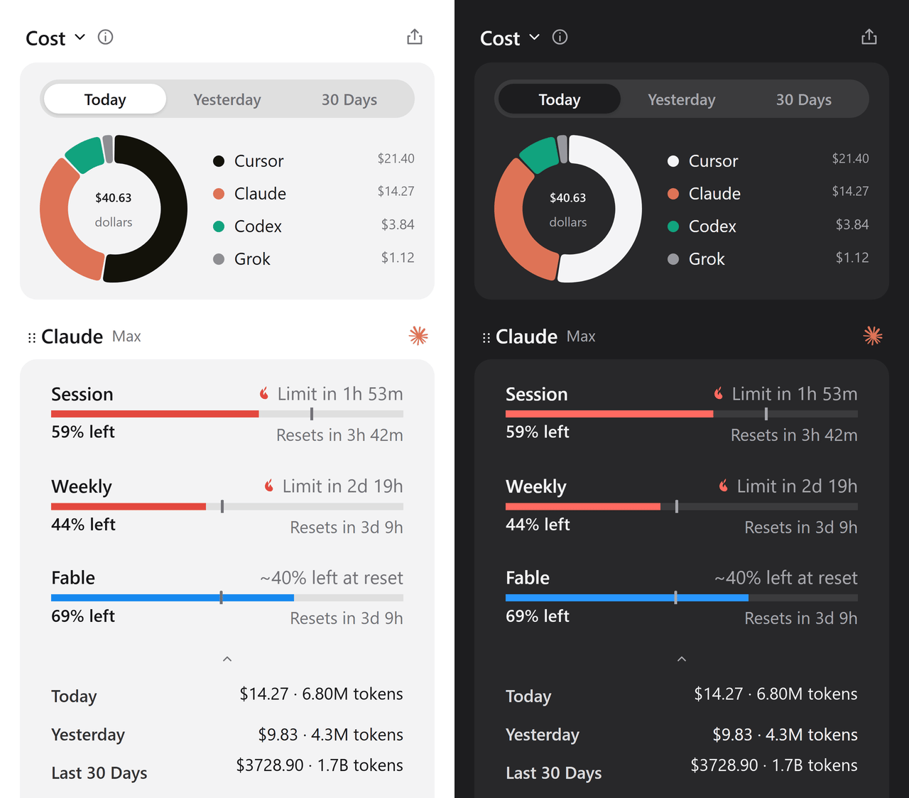

<h1 align="center">QuotaGauge</h1>

  Track usage and limits across your AI coding tools.

Every AI coding tool tracks your usage somewhere else. Claude Code in the terminal, Codex in the browser, Copilot in a settings page, and the rest wherever they felt like putting it. QuotaGauge puts all of it in one compact panel that lives in your tray or menu bar: session and weekly limits, reset times, token usage, and estimated spend.

I picked this project up from [OpenUsage](https://github.com/robinebers/openusage) after it went quiet, and I keep it alive as a maintained continuation for Windows, Linux, and macOS. Thanks, robinebers, for the original work.

  

## Download

Grab the latest build for your platform from the [releases page](https://github.com/EstebanForge/QuotaGauge/releases/latest). Fair warning: the installers are not signed with paid certificates yet, so Windows SmartScreen and macOS Gatekeeper will push back on first run. [Installation](docs/installation.md) covers the details, including the one command that clears macOS's warning, plus how to bring your OpenQuota data along on first launch.

## Providers

QuotaGauge reads 12 providers out of the box. Most of them use the credentials already sitting on your machine. OpenRouter, Z.ai, Kimi, and MiniMax need an API key you add in Customize, and Codex subscription limits need a ChatGPT login.

- [Claude Code](docs/providers/claude.md)
- [Codex](docs/providers/codex.md)
- [Cursor](docs/providers/cursor.md)
- [Antigravity](docs/providers/antigravity.md)
- [Copilot](docs/providers/copilot.md)
- [Devin](docs/providers/devin.md)
- [Grok](docs/providers/grok.md)
- [OpenCode](docs/providers/opencode.md)
- [OpenRouter](docs/providers/openrouter.md)
- [Z.ai](docs/providers/zai.md)
- [Kimi](docs/providers/kimi.md)
- [MiniMax](docs/providers/minimax.md)

Each provider has its own guide with everything it reads and where it reads it from.

## Features

- Tray or floating dashboard, with pinned metrics in the tray or macOS menu bar
- Show quota used or quota remaining
- 30 days of usage history with estimated spend
- Pacing alerts: will your quota last until the next reset?
- Custom layouts: reorder providers, hide rows, choose what stays visible
- Launch at login, global shortcut, system theme
- Cached values show instantly, refreshes happen in the background

Everything runs locally. No account, no cloud backend, no analytics, no telemetry of its own.

## Development

You need Node.js 22 or later, pnpm 11.11.0, and a stable Rust toolchain. [Development](docs/development.md) has the setup, the quality checks, and the build commands.

## Contributing

Issues and pull requests are welcome. Please read [CONTRIBUTING.md](CONTRIBUTING.md) first, and report security problems privately through [SECURITY.md](SECURITY.md).

## Credits

Thanks to [robinebers](https://github.com/robinebers) ([OpenUsage](https://github.com/robinebers/openusage)) for the original idea this whole project was born from.

Thanks to [deviffyy](https://github.com/deviffyy) ([OpenQuota](https://github.com/deviffyy/OpenQuota)) for forking the original app before it dropped Windows and Linux support to go macOS-only, and for keeping those versions alive until I picked the project up.

## License

[MIT](LICENSE)
